<div align="center">

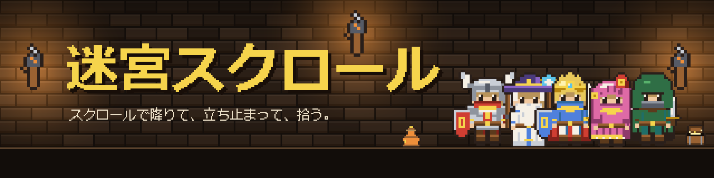

<br>

**いつものブラウジングに、小さな冒険を足す Chrome 拡張機能**

<br>


<br>

[インストール](#install) ・ [特長](#features) ・ [画面](#screens) ・ [設定](#settings) ・ [プライバシー](#privacy) ・ [フレンド機能](#friends) ・ [開発](#dev)

</div>

<br>

- 画面の右端で、探索者が迷宮を降りていきます。
- スクロールを止めると、壺や宝箱が現れます。
- 見つかるのは、いま見ているサイトにちなんだ品です。
- 操作も管理も要りません。ページを読むだけで遊べます。

<p align="center"></p>

<a id="install"></a>

##  インストール

ビルド済みの拡張機能が `dist/` に入っています。

1. このリポジトリを ZIP でダウンロードして、展開します。
2. Chrome で `chrome://extensions` を開き、「デベロッパーモード」をオンにします。
3. 「パッケージ化されていない拡張機能を読み込む」で、`dist` フォルダを選びます。
4. 好きなページをスクロールしてみてください。

> [!NOTE]
> 学校や会社のアカウントでは、使えない場合があります。<br>
> 個人のプロファイルで使ってください。

<p align="center"></p>

<a id="features"></a>

## 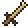 特長

<table>
<tr>
<td align="center" valign="top" width="33%">
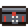<br>
<b>サイトで品が変わる</b><br>
<sub>動画、SNS、ニュース、学習など、<br>サイトの種類ごとに品が違います。</sub>
</td>
<td align="center" valign="top" width="33%">
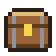<br>
<b>立ち止まるたびに1つ</b><br>
<sub>止めて1秒で入れ物が現れ、<br>約4秒の物色で中身が見つかります。</sub>
</td>
<td align="center" valign="top" width="33%">
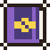<br>
<b>職業が診断される</b><br>
<sub>集めた品の傾向で職業が決まります。<br>組み合わせの職業は全45通りです。</sub>
</td>
</tr>
<tr>
<td align="center" valign="top">
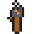<br>
<b>帯が深さに合わせて変わる</b><br>
<sub>壁の色と飾りが深さに合わせて移ります。<br>朝は明るく、夜は暗くなります。</sub>
</td>
<td align="center" valign="top">
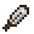<br>
<b>フレンドと比べられる</b><br>
<sub>今週のポイントを比べられます。<br>ログインしなくても遊べます。</sub>
</td>
<td align="center" valign="top">
<br>
<b>記録しない</b><br>
<sub>ページの URL・タイトル・本文は、<br>記録も送信もしません。</sub>
</td>
</tr>
</table>

<p align="center"></p>

<a id="screens"></a>

##  画面

<table>
<tr>
<td align="center" valign="top">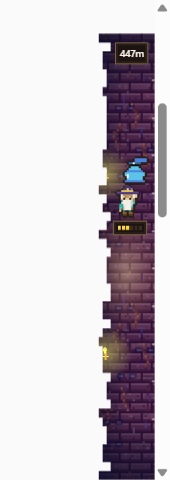<br><sub>右端の帯</sub></td>
<td align="center" valign="top">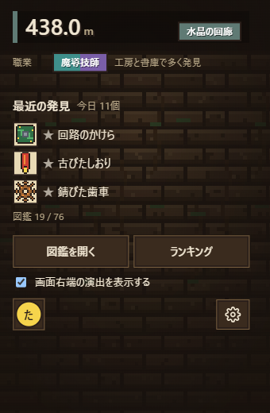<br><sub>ポップアップ</sub></td>
<td align="center" valign="top">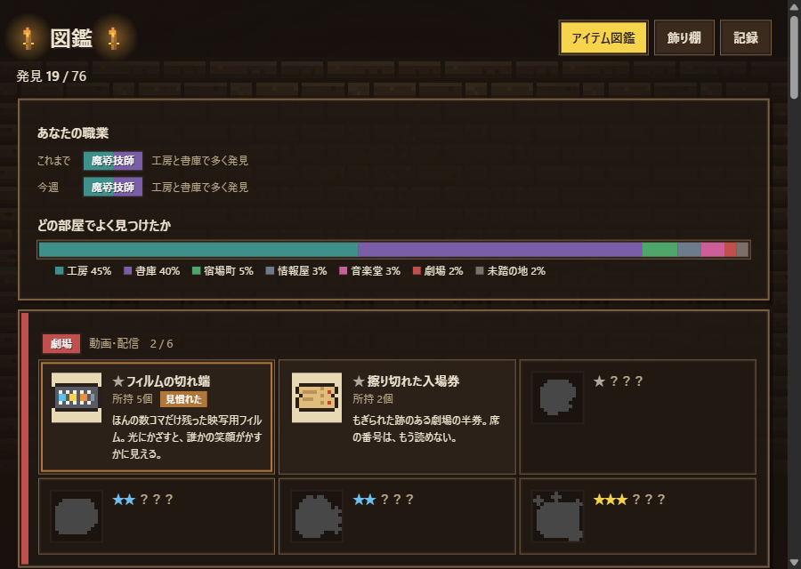<br><sub>図鑑</sub></td>
</tr>
</table>

- ポップアップで深さ、職業、最近の発見を見られます。右下の歯車が設定です。
- 図鑑には、発見品の一覧、飾り棚（3つまで）、日ごと・週ごとの記録があります。
- ランキング・フレンドで今週のポイントを比べます。順位はポイントの合計だけで決まります。
- 設定で帯の位置と大きさ、時間帯の演出、ゲームを動かさないサイトを選べます。

くわしい遊び方は [docs/GAMEPLAY.md](docs/GAMEPLAY.md) にまとめています。

<p align="center"></p>

<a id="settings"></a>

##  設定

ポップアップの右下にある歯車から開きます。

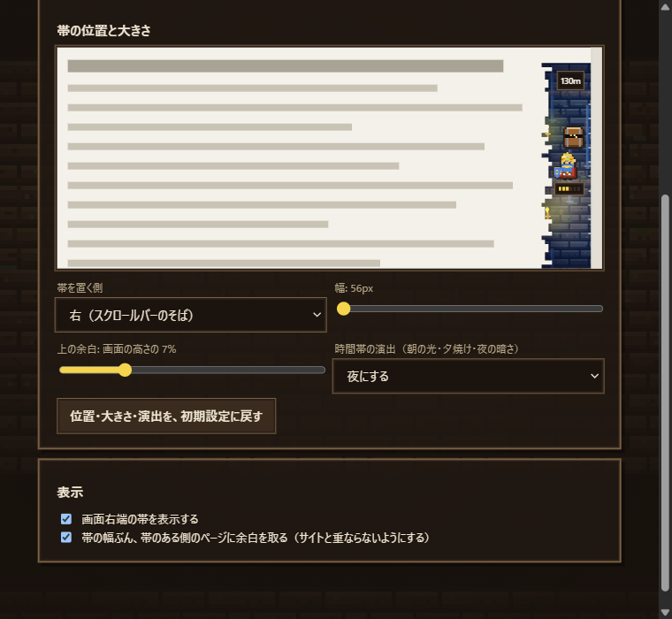

- 帯の左右の位置、幅（56〜104px）、上の余白を変えられます。
- 時間帯の演出は端末の時計に合わせるか、朝・昼・夕方・夜に固定するか、なしにできます。
- 設定の上の見本で、変えた結果をすぐ確かめられます。
- ゲームを動かさないサイトに登録すると、帯が出ず、品も見つかりません。ポップアップのスイッチからも登録できます。

<p align="center"></p>

<a id="privacy"></a>

## 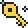 プライバシー

<table>
<tr>
<td valign="top" width="50%">

### 記録しないもの

- 見たページの URL、サイト名、タイトル、本文
- 入力した内容

### 端末の中だけで行うこと

- サイトの種類は拡張機能の中で、ホスト名を辞書と照合して決めます。
- 残すのは「種類」だけです。
- 成人向け・医療・金融などのサイトは、辞書に載せていません。

</td>
<td valign="top" width="50%">

### 端末に保存するもの

- 深さ、図鑑、飾り棚、日ごとの集計、設定

### Firebase に送るもの

フレンド機能を使うときだけ送ります。

- ニックネーム、フレンドコード、フレンド一覧
- 今週のポイントと発見数
- Google アカウントのアイコン（画像の URL）
- 図鑑・飾り棚・部屋の分布は、公開設定で「見せる」にしたものだけを送ります。初期設定は「見せない」です。

</td>
</tr>
</table>

本名とメールアドレスは、他の人には見えません。

<p align="center"></p>

<a id="friends"></a>

##  フレンド機能（任意）

ログインとフレンド機能には、自分の Firebase プロジェクトが必要です。<br>
手順は [docs/FRIENDS.md](docs/FRIENDS.md) にあります。ゲーム本体は設定なしで遊べます。

##  よくある質問

<details>
<summary><b>拡張機能のカードが、再起動のあとに消える</b></summary>

<br>

学校や会社のアカウントで起きます。<br>
管理者がデベロッパーモードの拡張機能を許可していない可能性があります。<br>
個人のプロファイルに読み込むと、消えません。

</details>

<details>
<summary><b>品が見つからない</b></summary>

<br>

- そのサイトを、「ゲームを動かさないサイト」に登録していませんか。
- 1日の上限（300個）に、届いていませんか。
- 拡張機能を更新したあと、ページを再読み込みしましたか。

</details>

<details>
<summary><b>帯が、サイトの表示と重なる</b></summary>

<br>

設定で、「帯のある側のページに余白を取る」をオンにしてください。

</details>

<details>
<summary><b>フレンド機能で、エラーが出る</b></summary>

<br>

[docs/FRIENDS.md](docs/FRIENDS.md#困ったとき) を見てください。

</details>

<p align="center"></p>

<a id="dev"></a>

## 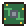 開発

```bash
npm install
npm run build   # 型チェックのあと、dist/ に出力
npm test        # 単体テスト（Vitest）
npm run dev     # 開発用
```

- ビルドのあとに `chrome://extensions` で拡張機能を更新し、開いているページを再読み込みします。
- `dist/` は、ダウンロードしてすぐ使えるように、コミットしています。

```text
.
├── src/        core（判定・計算）/ content / background / 各画面 / firebase / data
├── pages/      画面の入り口（HTML）
├── firestore/  セキュリティルール（自動生成）
├── tools/      ドット絵・ルールの生成ツール
├── tests/      単体テスト
├── docs/       ドキュメントと画像
└── dist/       ビルド済みの拡張機能
```

##  ドキュメント

<table>
<tr>
<td><a href="docs/GAMEPLAY.md"><b>遊び方の詳細</b></a></td>
<td>部屋と職業、品と確率、入れ物、帯、ランキング</td>
</tr>
<tr>
<td><a href="docs/FRIENDS.md"><b>フレンド機能の準備</b></a></td>
<td>Firebase の設定、しくみ、困ったとき</td>
</tr>
<tr>
<td><a href="docs/DEVELOPMENT.md"><b>開発メモ</b></a></td>
<td>構成、調整できる値、生成ツール、保存データ</td>
</tr>
<tr>
<td><a href="docs/CONCEPT-DUNGEON.md"><b>コンセプト</b></a> ・ <a href="docs/PHASE4.md"><b>フレンドの設計</b></a></td>
<td>企画と設計のメモ</td>
</tr>
</table>

<p align="center"></p>

<div align="center">

<sub>スクロールで降りて、立ち止まって、拾う。</sub>

</div>
