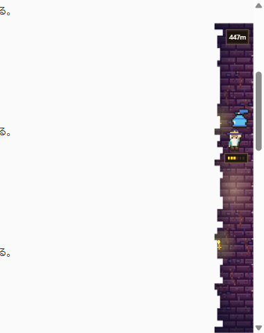

<div align="center">


# 迷宮スクロール

**スクロールで降りて、立ち止まって、拾う。**<br>
いつものブラウジングに、ちょっとした冒険を足す Chrome 拡張機能です。




</div>

ページを下へスクロールすると、画面の右端で探索者が迷宮を降りていきます。スクロールを止めると壺や宝箱が現れ、いま見ているサイトにちなんだ品が1つ見つかります。操作も管理も要りません。ページを読むだけで遊べます。

##  インストール

ビルド済みの拡張機能が `dist/` に入っています。

1. このリポジトリを ZIP でダウンロードして展開します（「Code」→「Download ZIP」）。
2. Chrome で `chrome://extensions` を開き、「デベロッパーモード」をオンにします。
3. 「パッケージ化されていない拡張機能を読み込む」から、展開したフォルダの **`dist`** を選びます。
4. 好きなページをスクロールしてみてください。

> [!NOTE]
> 学校や会社が管理しているアカウントでは、拡張機能が使えなかったり、再起動のたびに消えたりすることがあります。個人のプロファイルで使ってください。

##  特長

| | |
|---|---|
|  **サイトで品が変わる** | 動画、SNS、ニュース、学習、買い物など、見ているサイトの種類で、見つかる品が変わります |
|  **立ち止まるたびに1つ** | 止めて1秒で入れ物が現れ、約4秒の物色のあと、中身が見つかります。まれに宝箱がミミックです |
|  **職業が診断される** | 集めた品の傾向から、探索者の職業が決まります。2つの傾向が強いと、組み合わせの職業になります（全45通り） |
|  **帯が深さに合わせて変わる** | 壁の色と飾りが、スクロールに合わせてなめらかに変わります。夜は暗く、朝は明るくなります |
|  **フレンドと比べられる** | ログインすると、今週のポイントを比べられます。使わなくても、遊べます |
|  **記録しない** | 見たページの URL・タイトル・本文は、記録も送信もしません |

##  画面

<table>
<tr>
<td align="center" valign="top"><br><sub>ポップアップ</sub></td>
<td align="center" valign="top"><br><sub>図鑑（職業診断・部屋の分布・発見品）</sub></td>
</tr>
</table>

- **ポップアップ:** 深さ、職業、最近の発見。左下にログイン中のアイコン、右下に設定の歯車があります。
- **図鑑:** 発見品の一覧、飾り棚（3つまで）、日ごと・週ごとの記録。同じ品を何度も見つけると、カードの枠が銅・銀・金・虹と変わります。
- **ランキング・フレンド:** 自分とフレンドの今週のポイントを比べます。順位は、今週のポイントの合計だけで決まります。
- **設定:** [帯の位置と大きさ](#帯の位置と大きさ)、時間帯の演出、ゲームを動かさないサイトを選べます。

##  設定

ポップアップの右下の歯車から開きます。

### 帯の位置と大きさ


- 左右どちらに置くか、幅（56〜104px）、上の余白を変えられます。
- 時間帯の演出は、端末の時計に合わせるか、朝・昼・夕方・夜に固定するか、なしにできます。
- 設定画面の見本で、変えた結果をすぐ確かめられます。

### ゲームを動かさないサイト

登録したサイトでは、帯を出さず、スクロールも数えず、品も見つかりません。サブドメインも含みます。ポップアップのスイッチからも登録できます。

##  プライバシー

- **記録しない:** 見たページの URL、サイト名、タイトル、本文、入力した内容
- **端末の中だけで判定:** サイトの種類は、拡張機能の中でホスト名を辞書と照合して決めます。残すのは「種類」だけです。成人向け・医療・金融などのサイトは、辞書に載せていません。
- **端末に保存:** 深さ、図鑑、飾り棚、日ごとの集計、設定
- **フレンド機能を使うときだけ、Firebase に送る:** ニックネーム、フレンドコード、フレンド一覧、今週のポイントと発見数、Google アカウントのアイコン。図鑑・飾り棚・部屋の分布は、公開設定で「見せる」にしたときだけ送ります（初期設定は「見せない」）。
- 本名とメールアドレスは、他の人には見えません。

##  フレンド機能（任意）

Google ログインとフレンド機能には、自分の Firebase プロジェクトが必要です。設定の手順は [docs/FRIENDS.md](docs/FRIENDS.md) にあります。ゲーム本体は、設定なしで遊べます。

##  よくある質問

<details>
<summary><b>拡張機能のカードが、再起動のあとに消える</b></summary>

<br>

学校や会社のアカウントで起きます。管理者が、デベロッパーモードの拡張機能を許可しない設定（`ExtensionDeveloperModeSettings` など）にしている可能性があります。個人のプロファイルに読み込むと、消えません。

</details>

<details>
<summary><b>品が見つからない</b></summary>

<br>

次を確認してください。

- そのサイトが「ゲームを動かさないサイト」に入っていませんか。
- 1日の上限（300個）に届いていませんか。
- 拡張機能を更新したあと、ページを再読み込みしましたか。

</details>

<details>
<summary><b>帯がサイトの表示と重なる</b></summary>

<br>

設定で「帯のある側のページに余白を取る」がオンか確認してください。

</details>

<details>
<summary><b>フレンド機能でエラーが出る</b></summary>

<br>

[docs/FRIENDS.md](docs/FRIENDS.md#困ったとき) を見てください。

</details>

##  開発

```bash
npm install
npm run build   # 型チェックのあと、dist/ に出力
npm test        # 単体テスト（Vitest）
npm run dev     # 開発用
```

ビルドのあとは、`chrome://extensions` で拡張機能を更新し、開いているページを再読み込みします。`dist/` は、ダウンロードしてすぐ使えるように、コミットしています。

```text
.
├── src/            core（判定・計算）/ content（ページ側）/ background / 各画面 / firebase / data
├── pages/          画面の入り口（HTML）
├── firestore/      セキュリティルール（自動生成）
├── tools/          ドット絵・ルールの生成ツール
├── tests/          単体テスト
├── docs/           ドキュメントと画像
└── dist/           ビルド済みの拡張機能
```

詳しくは [docs/DEVELOPMENT.md](docs/DEVELOPMENT.md) にまとめています。

##  ドキュメント

| | |
|---|---|
| [遊び方の詳細](docs/GAMEPLAY.md) | 部屋と職業、品と確率、入れ物、帯、ランキング |
| [フレンド機能の準備](docs/FRIENDS.md) | Firebase の設定、しくみ、困ったとき |
| [開発メモ](docs/DEVELOPMENT.md) | 構成、調整できる値、生成ツール、保存データ |
| [コンセプト](docs/CONCEPT-DUNGEON.md) / [フレンド設計](docs/PHASE4.md) | 企画と設計のメモ |
