#  遊び方の詳細

[← README に戻る](../README.md)

## 基本の流れ

1. 下にスクロールします。迷宮を降りて、深さが増えます。
2. 止めます。1秒たつと、入れ物が1つ現れます。
3. 探索者が約4秒かけて、入れ物をあさります。
4. 品が見つかり、そのまま図鑑に入ります。

深さは1000px のスクロールで約 26m 増えます。

> [!IMPORTANT]
> 見つかる品は、1回の立ち止まりにつき1つです。 
> 止まり続けても増えません。もう一度スクロールしてから止まると、次の入れ物が現れます。 
> 1日の発見数の上限は、300個です。

## 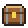 入れ物

| | 入れ物 | 確率 | 特徴 |
|:-:|---|--:|---|
|  | 壺 | 45% | ★1が出やすい |
| 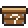 | 箱 | 40% | ふつう |
|  | 宝箱 | 15% | ★3が出やすい |
| 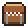 | ミミック | 宝箱の12% | 専用の戦利品 |

- 壺・宝箱・ミミックの見た目は階層ごとに変わります。
- 箱の見た目は部屋（サイトの種類）ごとに変わります。
- 階層は深さ 0・50・150・400・800・1500m で変わります。
- 深い階層ほど、★2・★3が出やすくなります。

## 見つかる品

| 種類 | 数 | 内容 |
|---|--:|---|
| 部屋の品 | 66 | 部屋ごとに6種（★1が3、★2が2、★3が1） |
| 階層の秘宝 | 6 | 階層ごとに1つ。約3%の確率 |
| ミミックの戦利品 | 4 | 宝箱に化けた魔物から |

★1 は1点、★2 は3点、★3 は10点です。

### なじみ具合

同じ品を何度も見つけると、図鑑のカードの枠と印が変わります。

| 所持数 | 印 | 枠 |
|--:|---|---|
| 3個 | 見慣れた | 銅 |
| 10個 | 使い込んだ | 銀 |
| 30個 | 極めた | 金 |
| 100個 | 伝説の | 虹 |

## 部屋（サイトの種類）

ページのホスト名を、端末の中で辞書と照合して、部屋を決めます。

| | 部屋 | サイト | 職業 |
|:-:|---|---|---|
| 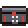 | 劇場 | 動画・配信 | 踊り子 |
| 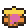 | 酒場 | SNS・掲示板 | 遊び人 |
| 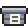 | 情報屋 | ニュース・ブログ | 斥候 |
| 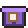 | 書庫 | 辞書・学習・技術文書 | 賢者 |
| 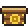 | 道具屋 | 買い物 | 商人 |
| 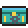 | 工房 | コード・開発者向け | 錬金術師 |
| 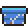 | 闘技場 | ゲーム・攻略 | 戦士 |
| 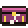 | 音楽堂 | 音楽 | 吟遊詩人 |
| 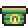 | 宿場町 | 地図・旅行・乗換案内 | 旅人 |
| 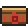 | ギルド | メール・カレンダー・仕事 | 騎士 |
|  | 未踏の地 | 上のどれでもないサイト | 放浪者 |

## 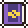 職業の決まり方

見つけた品が5個たまると、診断されます。 
上から順に、当てはまったものになります。

1. 上位2つの部屋がそれぞれ3割以上のときは、組み合わせの職業になります。 
   例: 工房 + 書庫 = 魔導技師
2. 1つの部屋が4割以上のときは、その部屋の職業になります。
3. どちらでもないときは、勇者になります。

- 1つの部屋が4割以上でも、2位が3割以上なら、組み合わせが優先です。
- 「未踏の地」は組み合わせに入りません。
- 組み合わせの職業の見た目は、2つの職業を合わせたものです。
  - 先の部屋の職業から、髪・帽子・持ち物
  - 後の部屋の職業から、服・背中・盾

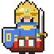 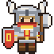 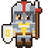   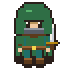 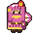 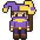  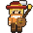  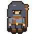

<b>組み合わせの職業の一覧（45通り）</b>

 

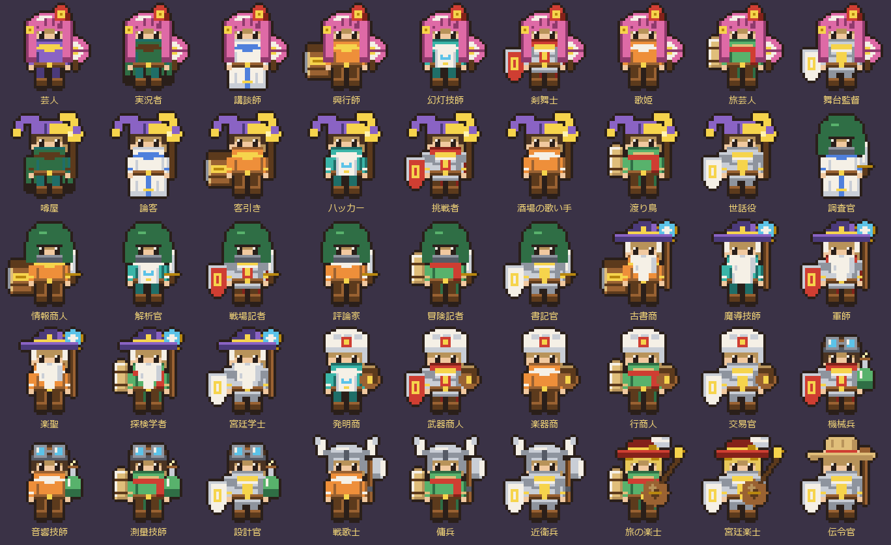

## 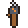 右端の帯

画面の右端（スクロールバーのすぐ左）に出る、細い帯です。

- 探索者は診断された職業の見た目で、ページを読み進めるほど帯の上から下へ降ります。
- ゲージは、物色の進みに合わせて6つの目盛りが点きます。
- 壁の絵はサイトの種類で変わります。劇場は赤いカーテン、書庫は本棚、工房は回路のタイルです。
- 壁の色と飾りは、100m ごとになめらかに移ります。土と根 → 水と苔 → 坑道の梁 → 水晶 → 溶岩 → 深い闇の順で、600m でひと回りします。
- 品を見つけた場所には、開けた入れ物の小さな絵が目印として残ります。 
  深く進むと壁といっしょに上へ流れ、帯から出ると消えます。保存はしません。
- 端末の時計に合わせて、朝は暖かい光、夕方は夕焼け、夜は青く暗くなります。夜は松明が明るく燃えます。 
  時刻は保存も送信もしません。

> [!TIP]
> OS の「視覚効果を減らす」がオンのときは、色を混ぜずに、200m ごとに切り替えます。

## ランキングの決まり方

- 順位は今週のポイントの合計だけで決まります。
- 週は月曜0時に始まります。
- 深さやスクロールの量では、順位をつけません。
- フレンドには、公開設定で「見せる」にした内容だけが見えます。
